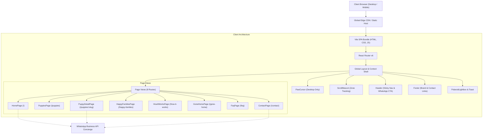
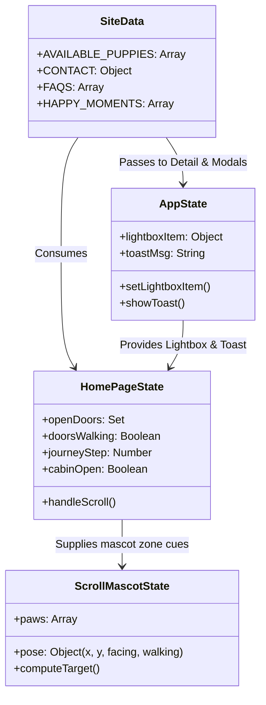

# TeddyPups U.A.E. — Technical Architecture Document

---

## 1. System Overview

**TeddyPups U.A.E.** is built as a high-performance, responsive Single-Page Application (SPA) powered by **React 18**, **React Router v6**, and **Vite 5**. The frontend architecture delivers rich interactive animations, SVG mascot walk cycles, 3D perspective door reveals, and frictionless lead conversion to WhatsApp.



---

## 2. Technology Stack & Technical Rationale

| Layer / Concern | Technology | Selection Rationale |
|---|---|---|
| **Core Framework** | React 18.2 | Component-driven architecture, hooks (`useRef`, `useState`, `useCallback`), declarative rendering |
| **Routing** | React Router DOM v6 | Fast client-side navigation without full-page reloads; URL parameter support (`:slug`) |
| **Build Tool & Bundler** | Vite 5.4 | Native ESM development server, sub-second HMR, optimized Rollup production builds |
| **Styling** | Vanilla CSS3 + Modern Variables | Zero runtime CSS-in-JS overhead; hardware-accelerated transforms, native view-box SVG pivots |
| **Typography** | Google Fonts (`Fraunces`, `Patrick Hand`) | Self-hosted or preconnected web fonts for storybook serif & handwritten typography |
| **Mascots & Assets** | Inlined SVG + WebP Images | Resolution independence, direct CSS control over internal SVG pivots (`transform-box: view-box`) |

---

## 3. Component Hierarchy & Architecture

```
src/
├── main.jsx                     # Application bootstrap & DOM mounting
├── App.jsx                      # App root, route definitions, global modals & cursor
├── index.css                    # Base resets, typography declarations, design tokens
├── components/
│   ├── Header.jsx               # Sticky navigation bar & WhatsApp quick CTA
│   ├── Footer.jsx               # Footer site map, legal copyright, sleeping mascot
│   ├── MascotSvgs.jsx           # SVG asset library (TeddyHeroMascot, PawIcon, WhatsAppIcon)
│   ├── TeddyRunnerMascot.jsx    # Full-body animated 4-leg walking cartoon poodle
│   ├── ScrollMascot.jsx         # Viewport-tracking floating mascot companion
│   ├── PawCursor.jsx            # Custom mouse cursor with interactive click burst
│   ├── PolaroidLightbox.jsx     # Reusable high-res polaroid image modal & toast
│   ├── RouteCurtain.jsx         # Transition curtain controller
│   └── ScrollReveal.jsx         # IntersectionObserver entrance animation wrapper
├── data/
│   └── siteData.js              # Centralized data store (Puppies, FAQs, Testimonials, Contact)
├── pages/
│   ├── HomePage.jsx             # Landing page with hero, pinned doors treadmill, & journey
│   ├── PuppiesPage.jsx          # Searchable, filterable puppy catalog
│   ├── PuppyDetailPage.jsx      # Individual puppy profile with WhatsApp builder
│   ├── HappyFamiliesPage.jsx    # Polaroid testimonial wall
│   ├── HowItWorksPage.jsx       # 5-step adoption process guide
│   ├── GoneHomePage.jsx         # Matched puppies archive
│   ├── FaqPage.jsx              # Categorized accordion knowledge base
│   └── ContactPage.jsx          # Showroom address, map, & booking form
└── styles/
    ├── animations.css           # Keyframes, mascot walk cycles, doors treadmill styles
    └── components.css           # Global buttons, cards, headers, lightbox styles
```

---

## 4. State Management & Data Architecture



### 4.1 Data Storage (`siteData.js`)
All static content, puppy inventories, FAQs, and contact points are centralized in `src/data/siteData.js`. This allows non-technical updates to puppy details, pricing, and media without modifying component logic.

### 4.2 Local vs. Lifted State
- **Global App State (`App.jsx`)**:
  - `lightboxItem`: Holds currently opened Polaroid image and caption for the full-screen modal.
  - `toastMsg`: Controls temporary non-blocking toast notifications.
- **Section State (`HomePage.jsx`)**:
  - `openDoors`: `Set<number>` tracking which doors in the 15-door treadmill are rotated open.
  - `doorsWalking`: Boolean flag debounced on scroll to activate leg trot keyframes on `TeddyRunnerMascot`.
  - `journeyStep`: Active step (1, 2, or 3) in the scroll-linked WhatsApp journey.
- **Mascot Companion State (`ScrollMascot.jsx`)**:
  - Interpolated coordinates `(x, y)` using `requestAnimationFrame` easing to follow the active `data-mascot-zone` element.

---

## 5. Animation & Interaction Engine

### 5.1 Horizontal Pinned 15-Door Treadmill
The "Meet the Pups" section utilizes a scroll-pinned viewport technique:
1. **Container Dimensioning**: The wrapper (`.tp-meet`) has `height: 350vh`.
2. **Sticky Stage**: Inside, `.tp-meet__stage` is `position: sticky; top: 0; height: 100vh; overflow: hidden;`.
3. **Scroll Interpolation**:
   ```javascript
   const scrollable = pinWrap.offsetHeight - window.innerHeight;
   const progress = Math.min(1, Math.max(0, -rect.top / scrollable));
   rail.scrollLeft = progress * (rail.scrollWidth - rail.clientWidth);
   ```
4. **Door Open Sequencing**: As progress increases, consecutive doors open automatically:
   ```javascript
   const openUpTo = Math.floor(progress * (AVAILABLE_PUPPIES.length + 1)) + 1;
   ```

### 5.2 Mascot Walk Animation Physics
In `TeddyRunnerMascot.jsx`, each limb specifies its anatomical origin in pixels matching the 300x240 viewBox:
- Front & Back Leg Origins: `(186px, 194px)`, `(94px, 192px)`, `(168px, 192px)`, `(110px, 194px)`.
- Tail Origin: `(84px, 150px)`.
- Ear Origins: `(174px, 82px)` and `(250px, 82px)`.

Using CSS `transform-box: view-box;`, the animations pivot naturally from the hips, shoulders, and head base.

---

## 6. Routing & Navigation Strategy

### 6.1 Declarative Route Map

| Path | Component | Description |
|---|---|---|
| `/` | `HomePage` | Primary landing page, mascot showcases, pinned treadmill |
| `/puppies` | `PuppiesPage` | Filterable directory of all showroom and incoming puppies |
| `/puppies/:slug` | `PuppyDetailPage` | Detailed dossier with direct WhatsApp lead builder |
| `/happy-families` | `HappyFamiliesPage` | Polaroid gallery of UAE adopter stories |
| `/how-it-works` | `HowItWorksPage` | Adoption roadmap, flight nanny, import regulations |
| `/gone-home` | `GoneHomePage` | Matched puppies archive celebrating completed adoptions |
| `/faq` | `FaqPage` | Comprehensive categorized accordion knowledge base |
| `/contact` | `ContactPage` | Downtown Dubai showroom location, hours, booking form |

### 6.2 Scroll Management (`ScrollManager`)
```javascript
function ScrollManager() {
  const { pathname, hash } = useLocation();
  useEffect(() => {
    if (hash) {
      const target = document.getElementById(hash.slice(1));
      if (target) {
        target.scrollIntoView({ behavior: 'smooth' });
        return;
      }
    }
    window.scrollTo({ top: 0, behavior: 'instant' });
  }, [pathname, hash]);
  return null;
}
```

---

## 7. Performance & Production Optimization

1. **Bundle Size**:
   - Production bundle compiles to `< 265 kB` JS (gzipped: `~77 kB`) and `< 60 kB` CSS (gzipped: `~13 kB`).
2. **Image Delivery**:
   - High-fidelity WebP images with responsive display widths (`aspect-ratio: 4/5.2` on doors).
   - Lazy-loading enabled on all below-the-fold door and catalog images (`loading="lazy"`).
3. **No Heavy 3D or Canvas Dependencies**:
   - All 3D door rotations and mascot trot cycles run natively via CSS3 GPU transforms (`rotateY`, `translate3d`), achieving consistent 60 FPS on both mobile and low-power devices.
4. **Hosting Targets**:
   - Deployable as static assets to Vercel, Netlify, Cloudflare Pages, or AWS S3 + CloudFront with clean URL rewrites:
     ```json
     { "rewrites": [{ "source": "/(.*)", "destination": "/index.html" }] }
     ```
