# TeddyPups U.A.E. — Implementation Phases (Page-by-Page)

---

## Roadmap Overview

This implementation roadmap organizes engineering, design, and content milestones into eight distinct phases, where **each phase represents a core page** of the TeddyPups platform.

```mermaid
flowchart LR
    P1["Phase 1: Home Page (/)"] --> P2["Phase 2: Puppies Catalog (/puppies)"]
    P2 --> P3["Phase 3: Puppy Profile (/puppies/:slug)"]
    P3 --> P4["Phase 4: Happy Families (/happy-families)"]
    P4 --> P5["Phase 5: How It Works (/how-it-works)"]
    P5 --> P6["Phase 6: Gone Home Archive (/gone-home)"]
    P6 --> P7["Phase 7: FAQ Knowledge Base (/faq)"]
    P7 --> P8["Phase 8: Visit & Contact (/contact)"]
```

---

## Phase 1: Home Page (`/`)

### 1.1 Objective
Establish brand positioning, visual enchantment, and immediate conversion triggers through the landing experience. Recreate the reference design with storybook mascots and the 15-door treadmill showcase.

### 1.2 Key Sections & Components
1. **Hero Section**:
   - Fraunces 800 display title: *"Premium teacup puppies in Dubai"*.
   - Cursive eyebrow *"every puppy is family"* with decorative wavy SVG stroke.
   - 6 arched puppy photo frames with realistic rotation tilts and speech tags.
   - Quilt scallop edge with dashed stitch lines.
   - Center-peeking `TeddyHeroMascot` with breathing animation.
2. **"Meet the Pups" Pinned 15-Door Showcase**:
   - 100vh full-bleed pinned treadmill track (`.tp-meet`).
   - 15 arched wooden doors (`.tp-door`) with 3D swinging leaves (`rotateY(78deg)`).
   - Door 1 (*Max*) and Door 2 (*Korean Teacup Maltipoo*) open by default.
   - Closed doors with authentic wood grain finishes, golden knobs, and tilted *"Available"* tags.
   - Honey-oak plank floor with top border line (`3px solid #2A170E`).
   - `TeddyRunnerMascot` standing on the floor line with 4-leg walk cycle animated on scroll.
3. **Two Ways to Meet**:
   - Side-by-side comparison: Dubai Showroom vs. Korean Teacup Import.
   - Illustrated wooden signpost graphic pointing to Dubai and Korea.
4. **WhatsApp Adoption Journey**:
   - Interactive 3-step timeline highlighting photo consultation, video calls, and home delivery.
5. **Puppy Passport & Health Guarantee**:
   - Visual certificates for microchip, international pet passport, vaccines, and flight carrier.
6. **Happy Families Preview**:
   - Polaroid grid with click-to-zoom Lightbox.
7. **Interactive FAQ Accordion**:
   - Quick answers to top questions.
8. **Flight Cabin Booking CTA**:
   - Airplane cabin graphic with direct booking inquiry button.

### 1.3 Acceptance Criteria
- [x] Hero matches reference design pixel-for-pixel.
- [x] 15-door track scrolls smoothly with active trot animations on the mascot.
- [x] Mascot paws sit flush on the 3px dark brown floor border.
- [x] Zero console warnings or layout shifts during scroll.

---

## Phase 2: Available Puppies Catalog (`/puppies`)

### 2.1 Objective
Provide an intuitive, fast, and visual catalog for prospective adopters to filter, discover, and inspect all available showroom and incoming puppies.

### 2.2 Key Features & Components
1. **Filter & Sort Navigation Bar**:
   - Origin filters: *All*, *In Dubai Showroom*, *Korean Teacup (Import)*.
   - Breed filters: *Maltipoo*, *Teacup Poodle*, *Cavapoo*, *Pomeranian*, *Shih Tzu*.
   - Gender toggles: *All*, *Boys*, *Girls*.
   - Video badge filter: *Only show puppies with video*.
2. **Puppy Card Grid (`.puppy-grid`)**:
   - Consistent arched frame aesthetic matching the home doors.
   - Badges: *"In Dubai"*, *"Korean Teacup"*, *"With Video"*, *"Available"*.
   - Photo display with gentle zoom on hover.
   - Price indication / inquiry CTA.
3. **Empty Results State**:
   - Friendly mascot illustration with CTA to request a custom breed search via WhatsApp.

### 2.3 Acceptance Criteria
- [ ] Filters update the URL query string (`?breed=maltipoo&origin=dubai`) for shareability.
- [ ] Card grid reflows responsively from 1 column (mobile) to 4 columns (desktop).
- [ ] Direct WhatsApp button passes puppy name into message draft.

---

## Phase 3: Puppy Detail Profile (`/puppies/:slug`)

### 3.1 Objective
Deliver a transparent, deep-dive profile for each puppy that answers every question regarding lineage, health, temperament, and logistics, culminating in a WhatsApp consultation.

### 3.2 Key Features & Components
1. **Media Stage**:
   - Multi-photo carousel with thumbnail strip.
   - Integrated showroom video player.
   - Full-screen zoom lightbox.
2. **Vital Specifications Table**:
   - Breed, Gender, Birth Date / Current Age, Color, Lineage.
   - Estimated Adult Weight (calculated using parent pedigree).
   - Current Location (*In Downtown Dubai showroom* or *Ready for DXB flight*).
3. **Health & Veterinary Dossier**:
   - Microchip registration status.
   - Vaccination log (Parvovirus, Distemper, Hepatitis, Rabies).
   - Official Veterinary Health Certificate.
   - 1-Year Genetic Health Warranty terms.
4. **Sticky WhatsApp Concierge CTA**:
   - High-contrast green button: *"Enquire about [Name] on WhatsApp"*.
   - Pre-fills: *"Hello, I am looking at [Name] ([Slug]) on TeddyPups. Can I see a video or book a viewing?"*
5. **Share & Toast Utility**:
   - Native Web Share API integration with fallback link copier and toast notification.

### 3.3 Acceptance Criteria
- [ ] Dynamic routing via React Router (`/puppies/:slug`) loads correct puppy data.
- [ ] 404 fallback page for invalid slugs with redirect to directory.
- [ ] Sticky action bar docks neatly on mobile viewports.

---

## Phase 4: Happy Families & Social Proof (`/happy-families`)

### 4.1 Objective
Build undeniable emotional proof and trust through an authentic gallery of UAE families with their TeddyPups companions.

### 4.2 Key Features & Components
1. **Polaroid Wall (`.polaroid-gallery`)**:
   - Hand-crafted white polaroid cards with frosted tape accents.
   - Random subtle rotation angles (`-3deg` to `+3deg`) for an authentic scrapbook feel.
   - Handwritten captions naming the puppy, family, and neighborhood (e.g., *"Luna with the Al Maktoum family in Jumeirah Islands"*).
2. **Interactive Lightbox (`PolaroidLightbox`)**:
   - Tap any polaroid to open full-resolution image with expanded family testimonial.
   - Next/Previous keyboard and swipe navigation.
3. **Community Submission Banner**:
   - Invitation for existing TeddyPups families to send new photos via WhatsApp for adoption anniversary gifts.

### 4.3 Acceptance Criteria
- [ ] Masonry/grid layout prevents awkward gaps across screen widths.
- [ ] Lightbox opens with silky scale-in transition and trap focus.
- [ ] Images load lazily with low-quality blurred placeholders.

---

## Phase 5: How It Works & Concierge Adoption (`/how-it-works`)

### 5.1 Objective
Demystify the luxury puppy adoption process, explaining veterinary safeguards, import regulations, and cabin travel logistics in clear, reassuring terms.

### 5.2 Key Features & Components
1. **5-Stage Process Roadmap**:
   - Step 1: *Personal Consultation & Video Meet*.
   - Step 2: *Medical Screening & UAE MOCCAE Import Permit*.
   - Step 3: *Flight Nanny Cabin Escort to DXB*.
   - Step 4: *Customs Clearance & Vet Health Inspection*.
   - Step 5: *Doorstep Delivery or Showroom Collection*.
2. **Flight Nanny Featurette**:
   - Highlights that puppies travel inside the temperature-controlled passenger cabin with a trained pet courier, never in cargo.
3. **Aftercare & Transition Support**:
   - Details on 24/7 puppy care hotline, complimentary vet check-up voucher in Dubai, and feeding guide.

### 5.3 Acceptance Criteria
- [ ] Step cards feature animated icon checkpoints on scroll.
- [ ] Clear callout of legal compliance with UAE animal welfare laws.

---

## Phase 6: Gone Home Archive (`/gone-home`)

### 6.1 Objective
Showcase past successes to reinforce brand credibility, highlight breed demand, and comfort buyers that TeddyPups maintains high placement volume.

### 6.2 Key Features & Components
1. **Archive Grid**:
   - Cards styled with gentle desaturation or gold ribbon badges: *"Adopted"*.
   - Adoption month and new home location.
2. **"Waitlist Similar Puppy" Trigger**:
   - Button on each card opening WhatsApp with: *"Hi, I saw [Pup Name] in Gone Home. Can you find me a similar [Breed]?"*

### 6.3 Acceptance Criteria
- [ ] Clear visual differentiation from currently available inventory.
- [ ] Instant filter to find past dogs of a specific breed.

---

## Phase 7: FAQ Knowledge Base (`/faq`)

### 7.1 Objective
Answer common objections, reassure first-time owners, and reduce repetitive customer support inquiries.

### 7.2 Key Features & Components
1. **Category Pills**:
   - *Health & Guarantee*, *Travel & Delivery*, *Teacup Puppy Care*, *Pricing & Deposits*.
2. **Animated Accordions**:
   - Smooth height transitions with SVG chevron rotation.
   - Accessible ARIA attributes (`aria-expanded`, `aria-controls`).
3. **Direct Concierge Fallback**:
   - Sticky card: *"Have a unique question? Our team is live on WhatsApp."*

### 7.3 Acceptance Criteria
- [ ] Accordion states preserve smooth 60fps expansion without text jumping.
- [ ] Fully navigable via keyboard Tab and Enter/Space keys.

---

## Phase 8: Visit & Contact (`/contact`)

### 8.1 Objective
Facilitate in-person showroom visits in Downtown Dubai and provide direct communication channels.

### 8.2 Key Features & Components
1. **Location & Visiting Hours**:
   - Downtown Dubai address with landmarks.
   - Operating hours (Daily 10:00 AM – 9:00 PM, by appointment).
2. **Interactive Map Card**:
   - Embedded Google Maps direction launcher.
3. **Appointment Booking Form**:
   - Inputs: Name, WhatsApp number, Preferred date, Desired breed.
   - Toast feedback confirming submission and redirecting to WhatsApp.
4. **Social & Direct Channels**:
   - Instagram, TikTok, WhatsApp, and email pills.

### 8.3 Acceptance Criteria
- [ ] Input validation for UAE phone numbers (+971...).
- [ ] Form submission generates a structured WhatsApp message draft.
